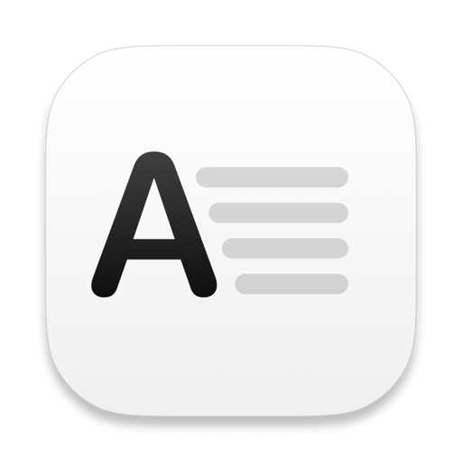
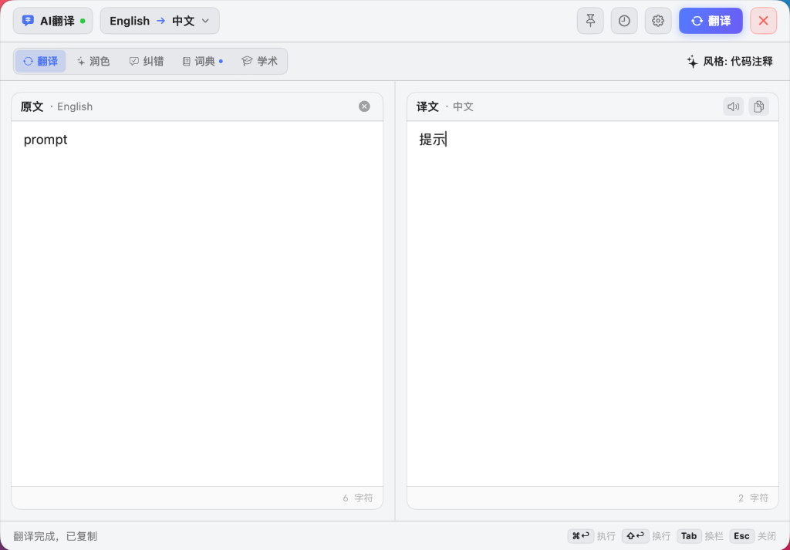
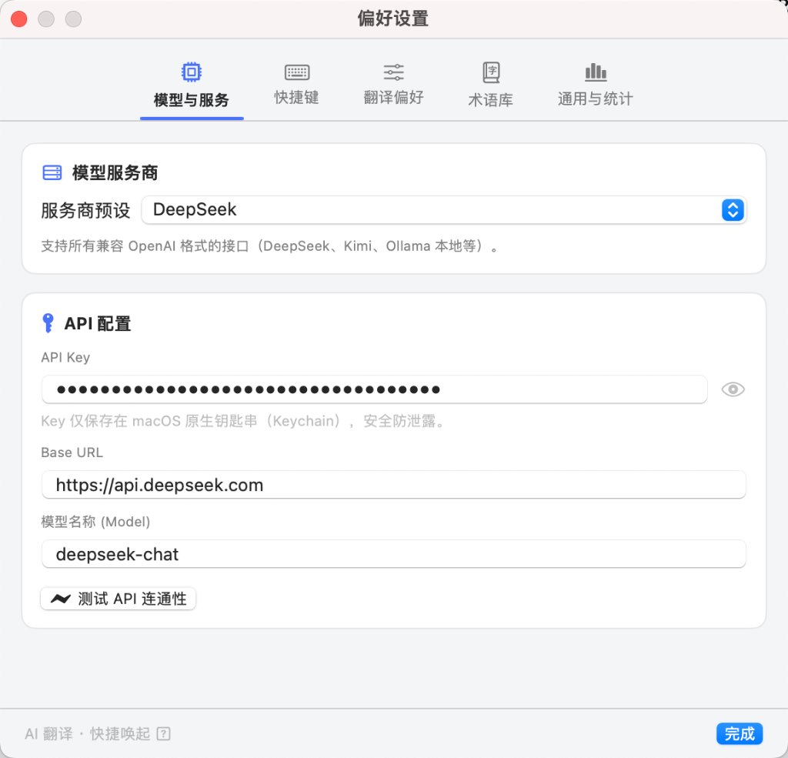
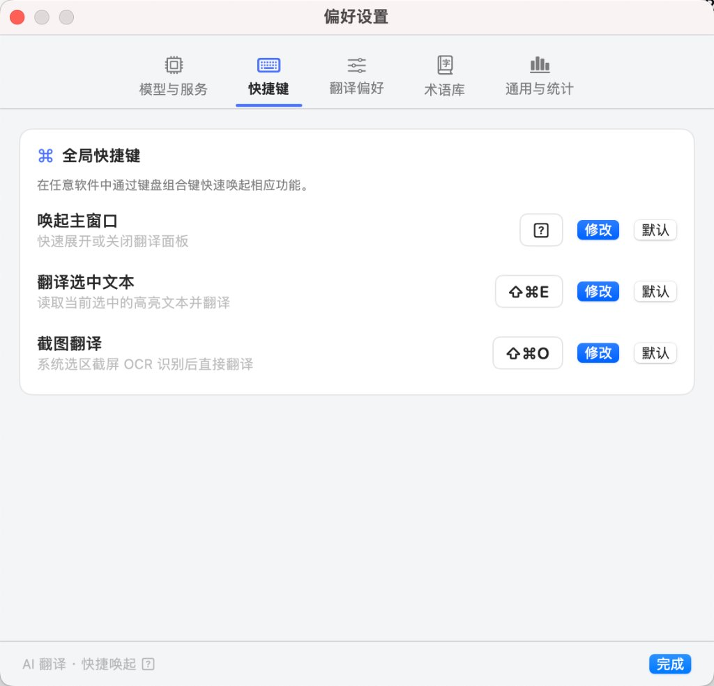
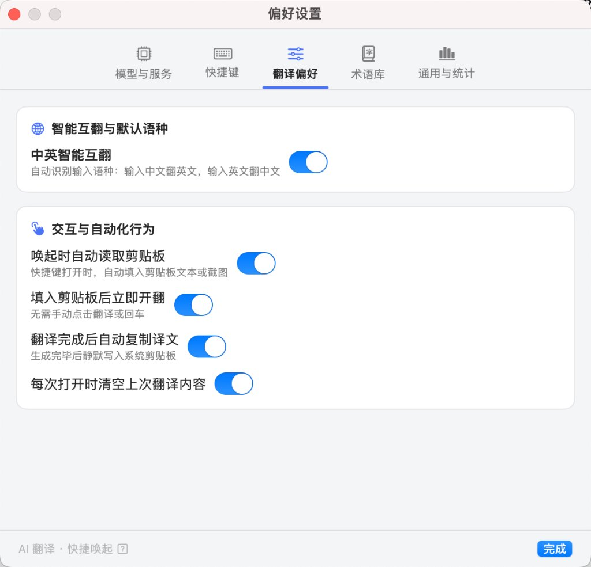
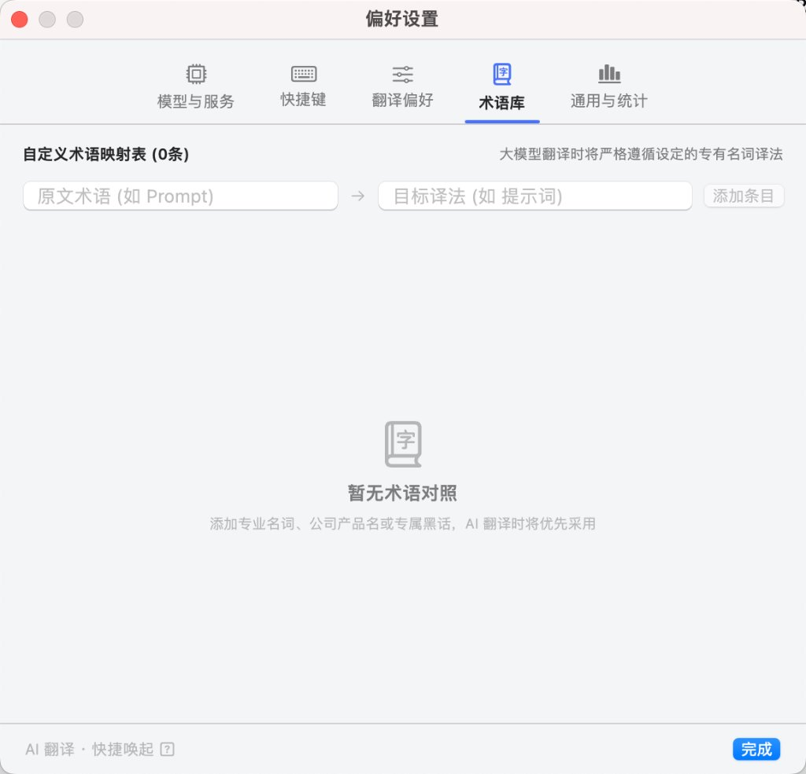

# AI 翻译 (AI Translator for macOS)

<p align="center">
  
</p>

<p align="center">
  <strong>专为 macOS 打造的高颜值、纯实色、极速沉浸式 AI 翻译与双语写作助手</strong>
</p>

<p align="center">
  <a href="#-主要功能"></a>
  <a href="#-主要功能"></a>
  <a href="#-服务商配置"></a>
  <a href="#-重新编译--打包"></a>
</p>

---

## 📸 界面预览

### 沉浸式纯实色主翻译窗口
左右对称卡片架构，配备统一 28pt 标尺规范、全区域热区响应与专属关闭按钮，杜绝壁纸透光发虚：

<p align="center">
  
</p>

### 现代卡片式偏好设置 (多 Tab 体系)

| 🤖 模型与服务 (含连通性测速) | ⌨️ 全局物理键帽快捷键 |
| :---: | :---: |
|  |  |
| **⚙️ 自动化与翻译偏好** | **📖 自定义专有术语库** |
|  |  |

---

## ✨ 核心特性

### 1. 🌟 五大 AI 动力处理模式
不仅是翻译，更是你的全能双语助手：
- **⇄ 智能翻译**：支持中英智能互翻及 13 种常见外语，保持格式与 Markdown 排版，支持流式逐字打字机输出。
- **✨ 地道润色 (Polish)**：将生硬表达改写为符合 Native Speaker 习惯的自然、优美、地道英语。
- **✍️ 语法纠错 (Grammar)**：深度纠正时态、单复数、介词等语法问题，并在文末清晰列出修改明细。
- **📖 深度词典 (Dictionary)**：输入单个单词或短语时智能感知，提供英/美音标、词性分布释义、高频短语搭配及 2 组地道双语例句。
- **🎓 学术改写 (Academic)**：一键转换为符合顶会期刊（Nature / IEEE / ACM）标准的严谨、客观、学术级英语。

### 2. 🎨 极致纯实色设计哲学 (Solid UI)
- **拒绝磨砂透光**：独创 `AppTheme` 色彩管理系统，深色模式采用深空石墨黑（`#16171B`），浅色采用纯净微灰白（`#F4F5F7`），无论桌面切换任何壁纸，界面永远纯正扎实。
- **像素级原生对齐**：通过 `NSTextView` 自定义重绘占位文字，光标与文字零重叠错乱；所有交互按钮拥有完整的 100% 矩形点击热区。
- **双栏 1:1 对称美学**：左右原文卡片与译文卡片 Header/Footer 完全等高对齐，内附字数统计与一键复制微动效。
- **Raycast 极客按键脚标**：底部置入物理质感的按键胶囊（`⌘↩ 执行`、`⇧↩ 换行`、`Tab 换栏`、`Esc 关闭`）。

### 3. 🚀 随心高效的多维交互
- **窗口图钉置顶 (Pin)**：右上角专属图钉按钮，未置顶时随用随走（失焦自动收起），置顶后常驻屏幕，方便对照写作或浏览文献。
- **划词即翻 (`⌘⇧E`)**：在任意网页、PDF 或代码编辑器中选中文字，快捷键直接唤起翻译。
- **截图翻译 (`⌘⇧O`)**：调用系统级截图选区，内置 Vision OCR 高精度识别文字并自动开翻。
- **中英智能检测**：自动识别输入语种（输入中文翻英文，输入英文翻中文），也支持手动一键 180° 对调。
- **专有术语表**：强制指定行业缩写或专有名词译法（如 `LLM → 大语言模型`），避免大模型幻觉。
- **多风格选择**：通用 / 正式 / 口语化 / 学术论文 / 代码注释 / 简短命名 自由切换。
- **安全第一**：API Key 严格保存在 macOS 系统钥匙串（Keychain）中，杜绝明文落盘。

---

## ⌨️ 常用快捷键

| 快捷键 | 作用说明 | 可否自定义 |
| :--- | :--- | :---: |
| **`⌘⇧T`** | 唤起 / 关闭翻译主窗口 | ✅ 偏好设置中录制 |
| **`⌘⇧E`** | 翻译当前屏幕上选中的高亮文本 | ✅ 偏好设置中录制 |
| **`⌘⇧O`** | 框选屏幕区域，截屏 OCR 后自动翻译 | ✅ 偏好设置中录制 |
| **`⌘↩` / `回车`** | 立即执行当前所选模式（翻译/润色/查词等） | 默认快捷键 |
| **`⇧ + 回车`** | 在输入框中进行换行排版 | 默认快捷键 |
| **`Tab`** | 在「原文输入框」与「译文编辑框」间切换焦点 | 默认快捷键 |
| **`Esc`** | 退出/隐藏翻译面板（右上角亦有显式关闭按钮） | 默认快捷键 |

---

## 🛠️ 服务商配置

支持所有兼容 **OpenAI Chat Completions 协议** 的大模型服务商，可在设置中直接切换并一键测速：

| 服务商 | Base URL | 默认模型推荐 | 适用场景 |
| :--- | :--- | :--- | :--- |
| **DeepSeek (默认)** | `https://api.deepseek.com` | `deepseek-chat` / `deepseek-reasoner` | 极高性价比、速度飞快、理解力出众 |
| **Moonshot Kimi** | `https://api.moonshot.cn/v1` | `moonshot-v1-8k` | 中文长文本上下文能力优秀 |
| **Ollama (本地私有)** | `http://127.0.0.1:11434/v1` | `qwen2.5:7b` / `llama3.3:8b` | 100% 离线、隐私敏感、无需 Key |
| **自定义 / OpenAI** | 自定义接口地址 | `gpt-4o-mini` / `claude` 兼容代理 | 满足个人反代或企业中转需求 |

> 💡 **提示**：API Key 仅保存在本机 macOS 系统 Keychain 中，完全安全。在设置页提供了「**测试 API 连通性**」按钮，填完后可秒级验证 Key 是否有效。

---

## 📥 下载与安装

### 方式一：下载即用
1. 下载最新的分发包：[`dist/AI-Translator-macOS.zip`](dist/AI-Translator-macOS.zip)；
2. 解压后将 `AI翻译.app` 拖入 `Applications`（应用程序）文件夹；
3. **首次打开**：右键点击 App → 选择「**打开**」。
   > 若系统提示“已损坏”或无法验证开发者，请打开终端执行：
   > ```bash
   > xattr -cr /Applications/AI翻译.app
   > ```

### 方式二：本地自行编译 (Swift SPM)
本项目使用纯原生 Swift Package + 原生脚本组装打包，无需庞大的 Xcode 工程环境依赖，仅需安装 Command Line Tools：

```bash
# 1. 克隆代码仓库
git clone https://github.com/tt-11-dd/ai-translation-mac.git
cd ai-translation-mac

# 2. 运行一键打包脚本 (编译 Universal 二进制 arm64 + x86_64 并组装 .app)
./build-app.sh
```

编译完成后会在桌面自动生成 `~/Desktop/AI翻译.app` 及分发压缩包。

---

## 📂 项目结构

```text
ai-translation-mac/
├── AITranslatorApp/                  # 核心 Swift 源码 (Swift Package)
│   ├── Package.swift                 # SPM 依赖与配置
│   └── Sources/AITranslator/
│       ├── AITranslatorApp.swift     # 应用程序入口与菜单栏 Extra
│       ├── Models/                   # 数据模型 (AppSettings, Language, HistoryStore, UsageStore)
│       ├── Services/                 # 底层服务
│       │   ├── DeepSeekTranslator.swift       # 核心流式请求与 5 大模式 Prompt 引擎
│       │   ├── TranslationPanelController.swift # 浮窗面板控制器 (置顶/位置持久化/样式)
│       │   ├── HotKeyManager.swift            # Carbon 全局快捷键注册与监听
│       │   ├── OCRService.swift               # Vision 原生高精度 OCR
│       │   ├── SelectedTextReader.swift       # 辅助功能选中文本抓取
│       │   ├── TTSSpeaker.swift               # macOS 原生多语言语音朗读
│       │   └── KeychainHelper.swift           # 钥匙串加密存取
│       └── Views/                    # SwiftUI 视图组件
│           ├── AppTheme.swift                 # 统一纯实色色彩规范系统
│           ├── TranslationPopupView.swift     # 主翻译面板 (双卡片 / 模式切换 / 快捷键)
│           ├── AutohidingTextEditor.swift     # 原生光标对齐 NSTextView 编辑器
│           └── SettingsView.swift             # 现代化多 Tab 偏好设置窗口
├── docs/images/                      # README 展示图集
├── build-app.sh                      # 一键编译生成 .app 与 Universal 架构脚本
├── logo.png                          # 官方应用图标
└── README.md
```

---

## 📄 License

本项目基于 [MIT License](LICENSE) 开源。
欢迎提出 Issue 或提交 Pull Request 一起打磨极致体验！
